<!-- Generated by scripts/readme.mjs. Edit data/profile.mjs, then run: npm run build -->

<picture>
  <source media="(prefers-color-scheme: dark)" srcset="./assets/hero-dark.svg">
  
</picture>

<a href="https://saiffardin.netlify.app"><picture>
  <source media="(prefers-color-scheme: dark)" srcset="./assets/link-portfolio-dark.svg">
  
</picture></a>
<a href="https://linkedin.com/in/saiffardin"><picture>
  <source media="(prefers-color-scheme: dark)" srcset="./assets/link-linkedin-dark.svg">
  
</picture></a>
<a href="mailto:saiffardin@gmail.com"><picture>
  <source media="(prefers-color-scheme: dark)" srcset="./assets/link-email-dark.svg">
  
</picture></a>
<a href="https://drive.google.com/file/d/1iUWybTEHNVq4J_ZTKYRZqLGKoYzACJec/view?usp=sharing"><picture>
  <source media="(prefers-color-scheme: dark)" srcset="./assets/link-resume-dark.svg">
  
</picture></a>

 

<picture>
  <source media="(prefers-color-scheme: dark)" srcset="./assets/impact-dark.svg">
  
</picture>

 

<picture>
  <source media="(prefers-color-scheme: dark)" srcset="./assets/stack-dark.svg">
  
</picture>

 

<picture>
  <source media="(prefers-color-scheme: dark)" srcset="./assets/header-work-dark.svg">
  
</picture>

<a href="https://onss.ecs.gov.bd"><picture>
  <source media="(prefers-color-scheme: dark)" srcset="./assets/project-ons-dark.svg">
  
</picture></a>
<a href="https://saiffardin.netlify.app/#experience"><picture>
  <source media="(prefers-color-scheme: dark)" srcset="./assets/project-ems-dark.svg">
  
</picture></a>

<a href="https://marriage.gov.bd"><picture>
  <source media="(prefers-color-scheme: dark)" srcset="./assets/project-marriage-dark.svg">
  
</picture></a>
<a href="https://i-trade-sass-v1.netlify.app/"><picture>
  <source media="(prefers-color-scheme: dark)" srcset="./assets/project-itrade-dark.svg">
  
</picture></a>

<a href="https://saiffardin.netlify.app/#experience"><picture>
  <source media="(prefers-color-scheme: dark)" srcset="./assets/project-billion-dark.svg">
  
</picture></a>
<a href="https://saiffardin.netlify.app/#experience"><picture>
  <source media="(prefers-color-scheme: dark)" srcset="./assets/project-yaana-dark.svg">
  
</picture></a>

 

<picture>
  <source media="(prefers-color-scheme: dark)" srcset="./assets/header-lab-dark.svg">
  
</picture>

- [**Ride Booking API**](https://github.com/saiffardin/L2-Assignment-05-RideBookingAPI) · Express · TypeScript · MongoDB · JWT roles
- [**Tour Management API**](https://github.com/saiffardin/tour-ms-be) · Express · Mongoose · Zod
- [**Creative Agency**](https://github.com/saiffardin/creative-agency-client) · MERN · Firebase Auth
- [**RTK Query + JWT**](https://github.com/saiffardin/rtk-query-jwt) · auth flow with token refresh

 

<picture>
  <source media="(prefers-color-scheme: dark)" srcset="./assets/path-dark.svg">
  
</picture>

 

<picture>
  <source media="(prefers-color-scheme: dark)" srcset="./assets/toolbox-dark.svg">
  
</picture>

 

<picture>
  <source media="(prefers-color-scheme: dark)" srcset="./assets/pulse-dark.svg">
  
</picture>

 

<picture>
  <source media="(prefers-color-scheme: dark)" srcset="./assets/footer-dark.svg">
  
</picture>
